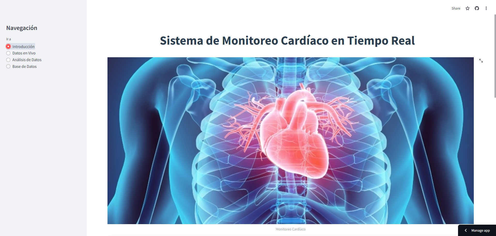
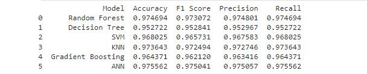
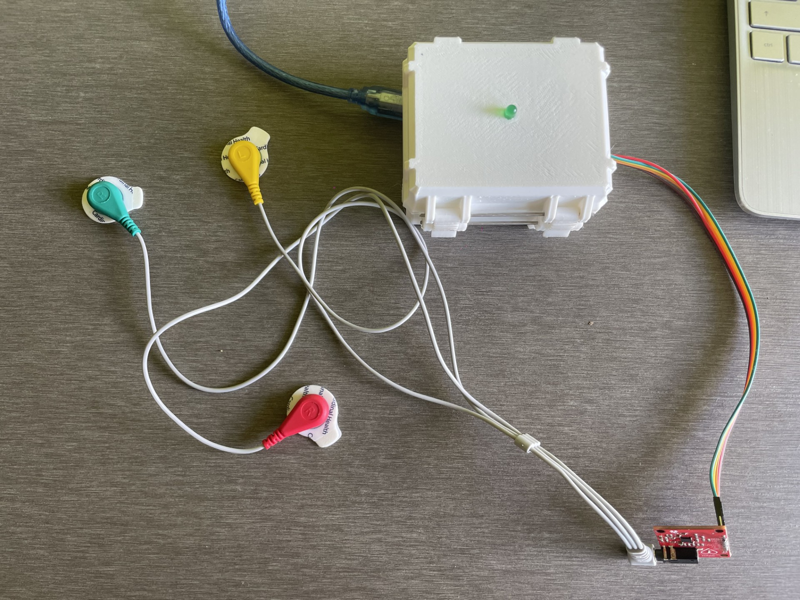
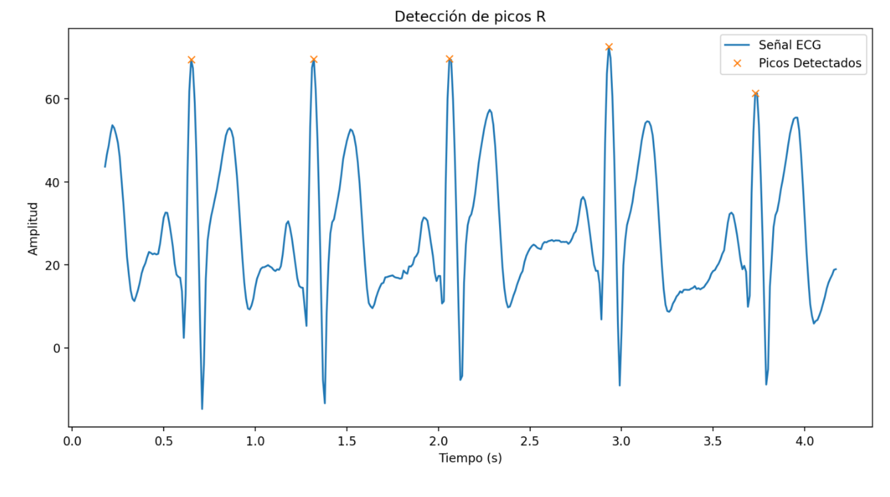
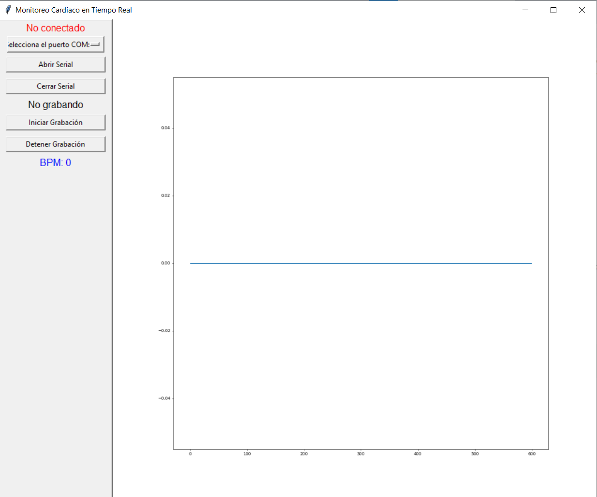
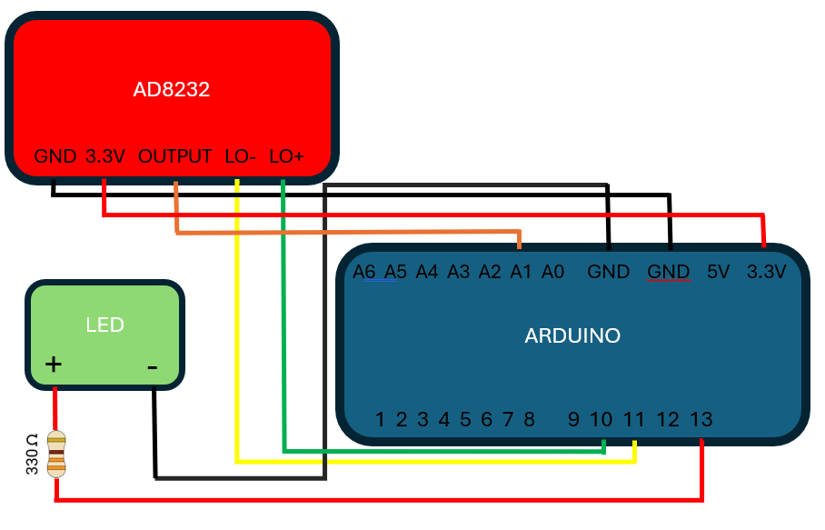
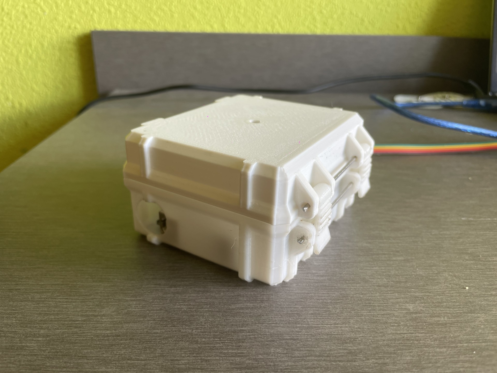

<div align="center">

# 🫀 Monitor Cardíaco en Tiempo Real con Clasificación de Latidos

**Aplicación web de monitorización de ECG con análisis predictivo de tipos de latido mediante Machine Learning**

Trabajo Fin de Grado · Ingeniería de la Salud · Universidad de Burgos




</div>

<details>
<summary>🇬🇧 <b>English summary</b></summary>

<br>

**Final Degree Project (Health Engineering, University of Burgos).** A low-cost, real-time heart monitor: an Arduino with an AD8232 ECG sensor streams the signal over serial to a Streamlit web app that plots the ECG live, computes heart rate (BPM), records sessions and classifies heartbeats with a Random Forest model trained on the MIT-BIH Arrhythmia database (97.5% accuracy). Predictions can be saved with a timestamp to a SQLite database, managed from the app and exported to CSV.

</details>

---

## 📋 Resumen

El monitoreo de la actividad cardíaca es crucial para la detección temprana y el manejo adecuado de diversas afecciones cardíacas. Sin embargo, los dispositivos de monitoreo disponibles en el mercado suelen ser caros y complejos a la hora de usarlos, lo que limita su accesibilidad para muchos pacientes.

En respuesta a esta necesidad, se ha desarrollado una **aplicación web accesible y económica para el monitoreo cardíaco en tiempo real**. Esta herramienta permite a los usuarios conectar el dispositivo de monitoreo cardíaco a través de un puerto serial, visualizar los datos de ECG en tiempo real y guardar las grabaciones para su posterior análisis, dentro de la misma aplicación web.

## ✨ Funcionalidades

- 🔌 Conexión y desconexión del dispositivo de monitoreo cardíaco.
- 📈 Visualización en tiempo real de los datos de ECG.
- 💓 Cálculo y visualización de la frecuencia cardíaca en LPM.
- 💾 Grabación y almacenamiento de los datos de ECG.
- 🤖 Predicción y clasificación de latidos cardíacos con un modelo **Random Forest**.
- 🗄️ Guardado de las predicciones (con fecha y hora) en una base de datos, con página de gestión y descarga en CSV.

## 🧠 Modelo y resultados

El modelo se ha entrenado con la base de datos **MIT-BIH Arrhythmia** y alcanza una **exactitud del 97,5 %** en la clasificación de latidos. Todo el proceso de tratamiento de datos, comparación de modelos y elección de Random Forest está documentado en [`analisis_datos_y_modelo.ipynb`](analisis_datos_y_modelo.ipynb).

<div align="center">

</div>

## 🔧 Hardware

| Componente | Uso |
|---|---|
| Arduino UNO | Adquisición y envío de la señal por puerto serie |
| Sensor AD8232 + electrodos | Captura de la señal ECG |
| KY-039 | Sensor de pulso (pruebas iniciales) |
| HC-05 | Comunicación Bluetooth (pruebas iniciales) |
| LED | Indicador sincronizado con el latido |

<div align="center">

</div>

## 🚀 Puesta en marcha

```bash
pip install -r requirements.txt
python model.py          # entrena el modelo y genera ecg_model.pkl
streamlit run streamlit.py
```

> Antes de entrenar, descarga `mitbih_train.csv` y `mitbih_test.csv` (ver [Datos](#-datos)) y déjalos junto a `model.py`. Carga en la placa el código de [`Arduino/Version 2`](Arduino/Version%202) antes de conectar el dispositivo.

## 📊 Datos

- **Entrenamiento y prueba:** [ECG Heartbeat Categorization Dataset](https://www.kaggle.com/datasets/shayanfazeli/heartbeat) (`mitbih_train.csv` y `mitbih_test.csv`), latidos segmentados de la base de datos pública [MIT-BIH Arrhythmia](https://physionet.org/content/mitdb/1.0.0/) de PhysioNet. No se incluyen en el repositorio por su tamaño.

## 🖼️ La aplicación en imágenes

| Detección de picos R en la señal | Monitor de escritorio en tiempo real |
|---|---|
|  |  |
| **Esquema de conexión AD8232 + Arduino** | **Carcasa impresa en 3D** |
|  |  |

## 📁 Estructura del repositorio

```
├── streamlit.py              # Aplicación web principal (Streamlit)
├── serialmonitor.py          # App de escritorio (Tkinter) para monitorización y grabación
├── model.py                  # Entrenamiento del modelo → ecg_model.pkl
├── analisis_datos_y_modelo.ipynb  # Análisis de datos y selección del modelo
├── requirements.txt          # Dependencias de Python
├── Arduino/
│   ├── Version 1/            # Pruebas iniciales con KY-039 y AD8232 (USB y Bluetooth)
│   └── Version 2/            # Código final: AD8232, USB, reducción de ruido, LED y autocalibración
├── fotos/                    # Imágenes usadas en la app web
└── Documentación_Proyecto/   # Memoria y anexos (PDF y LaTeX), imágenes y diagrama de Gantt
```

### Arduino
- **Version 1**: scripts iniciales de prueba para los sensores KY039 y AD8232.
  - `KY039_bluetooth.ino`: prueba del sensor KY039 con el módulo Bluetooth HC-05.
  - `ky039_usb.ino`: prueba del sensor KY039 con conexión USB.
  - `AD82CONPYTHONYELECTRODOS_bluetooth.ino`: prueba del sensor AD8232 con Bluetooth HC-05.
  - `AD82CONPYTHONYELECTRODOS_usb.ino`: prueba del sensor AD8232 con conexión USB.
- **Version 2**: versión final del código de Arduino.
  - `AD82_usb_y_led.ino`: código mejorado para el sensor AD8232 con comunicación USB, reducción de ruido, LED sincronizado y autocalibración.

## 📄 Documentación

- 📘 [Memoria del TFG (PDF)](Documentación_Proyecto/Memoria_Diego_Trascasa_García_firmado.pdf)
- 📗 [Anexos (PDF)](Documentación_Proyecto/Anexo_Diego_Trascasa_García.pdf)

## 👤 Autor

**Diego Trascasa García**: Grado en Ingeniería de la Salud, Universidad de Burgos

Tutor: Guirguis Zaki Guirguis Abdelmessih

---

<div align="center">
Distribuido bajo licencia MIT. Ver <a href="LICENSE">LICENSE</a>.
</div>
